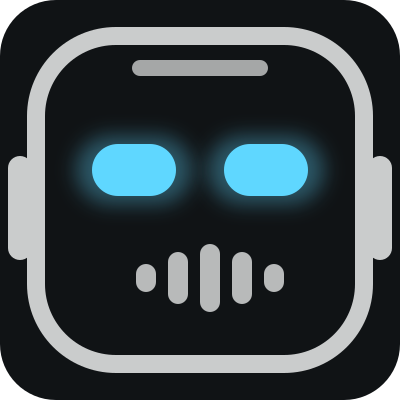

# larry.status — Larry's face in the Omarchy bar

Larry's face, drawn live in QML, reacting to what Larry is actually doing on this host.



## The face

| Mood | Trigger | Look |
|---|---|---|
| **asleep** | no Claude Code / Codex sessions running | eyes closed, dim |
| **idle** | agents running, all waiting on Fred | steady cyan, blinks |
| **thinking** | a session is reasoning (🧠 tab state) | narrowed eyes, slow pulse |
| **working** | a session is executing (⚙️ / spinner) | bright eyes, fast pulse |
| **needs you** | a session asked a question (❓) | amber, eyes look up |
| **speaking** | ElevenLabs is talking (VoiceServer → mpv) | green mouth equalizer |
| **alert** | qdrant / ollama / backup timer down, or heartbeat stale | red, wide eyes |

Next to the face: number of agents on deck (amber when one is waiting on you).

## Killer feature — Agents on Deck

The panel lists every live agent session on this host — Claude Code (Larry), Codex, OpenCode, Grok,
Gemini, Copilot, aider — with a crisp name, project dir, state, workspace, and age.

**Crisp names:** each process is matched to its own transcript by start time (±20 s), named from
the first real prompt, then upgraded to a 3–5 word title by local gemma2 via Ollama (async, cached
per session in `$XDG_RUNTIME_DIR/larry.status/`). `LARRY_STATUS_NO_LLM=1` to disable,
`LARRY_STATUS_LLM_MODEL=…` to change the model. Per-agent sources: Claude `~/.claude/projects/**/<sid>.jsonl`
→ `current-work-<sid>.json` → `session-names.json`; Codex `~/.codex/sessions/**/rollout-*.jsonl`;
OpenCode `opencode.db session.title`; Grok `~/.grok/sessions/<cwd>/prompt_history.jsonl`.
**Click a row, or press `1`–`9`, to jump straight to that terminal window.**
Right-click the bar face to cycle through agent windows without opening the panel.

Detached sessions (daemon-hosted Claude with no terminal on this host) are listed dimmed and can't be focused.

## Clicks & keys

- Left-click → panel · middle-click → `larry-heartbeat` now · right-click → next agent window
- Panel: `1–9` jump · `j`/`k` + Enter · `c` heartbeat (check) · `r` refresh · `Esc` close

## IPC

```
omarchy-shell larry.status status     # mood, agent counts, service health
omarchy-shell larry.status sessions   # JSON of agents on deck
omarchy-shell larry.status next       # focus next agent window
omarchy-shell larry.status check      # heartbeat now
```

## Files

- `BarWidget.qml` — bar face + badge, pollers (sessions 5s, voice 1.2s when enabled), IPC
- `Panel.qml` — control room
- `CyberFace.qml` — the face (size/mood driven, used in bar and panel)
- `larry_sessions.sh` — enumerates agent sessions: `/proc` → kitty ancestor → `hyprctl clients` → state from tab title
- `assets/` — static face for docs

## Data sources (all read-only)

- `~/.claude/MEMORY/STATE/heartbeat.status.json` (written by `larry-heartbeat.timer`)
- `~/.claude/MEMORY/STATE/session-names.json`, `kitty-sessions/*.json` (written by Larry's hooks)
- `~/.claude/voice.json` (the voice switch)
- `hyprctl clients -j`, `/proc`

## Dev

Source of truth: `~/Projects/larry.status` (git). Live copy: `~/.config/omarchy/plugins/larry.status`.
Never edit the live dir — Omarchy hot-reloads on every save and pops the panel. Sync with:

```
rsync -a --delete --exclude .git ~/Projects/larry.status/ ~/.config/omarchy/plugins/larry.status/ && omarchy-restart-shell
```

## Tests

```
tests/run.sh     # static checks, state-parser unit cases, collector JSON contract, live IPC round-trip
```
